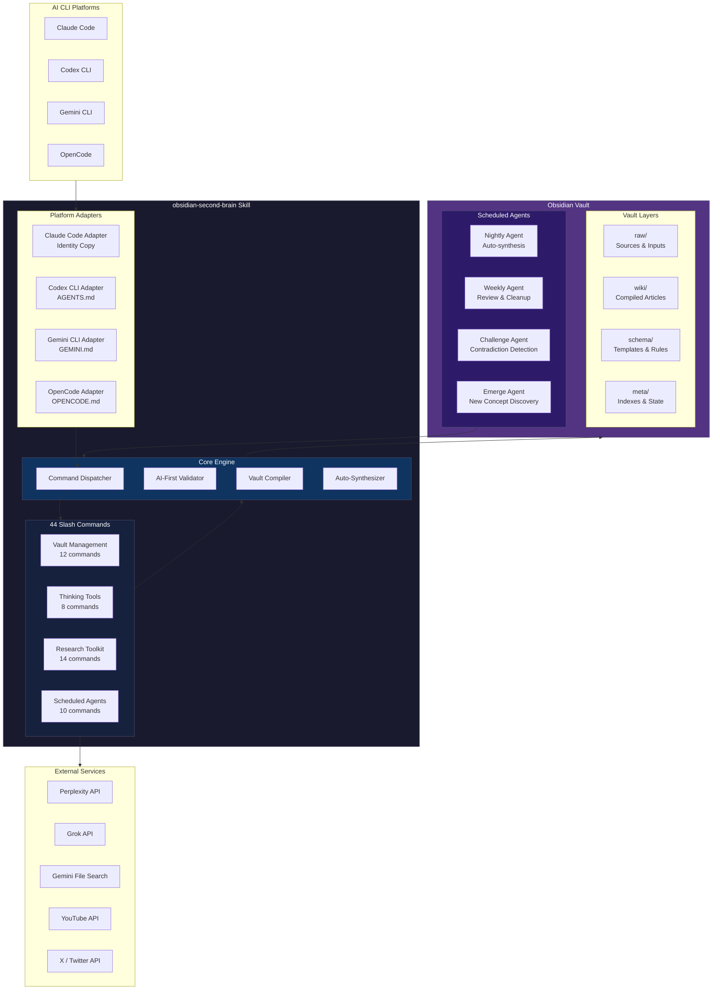
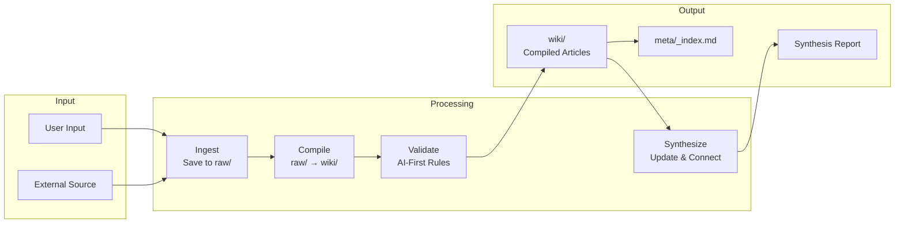
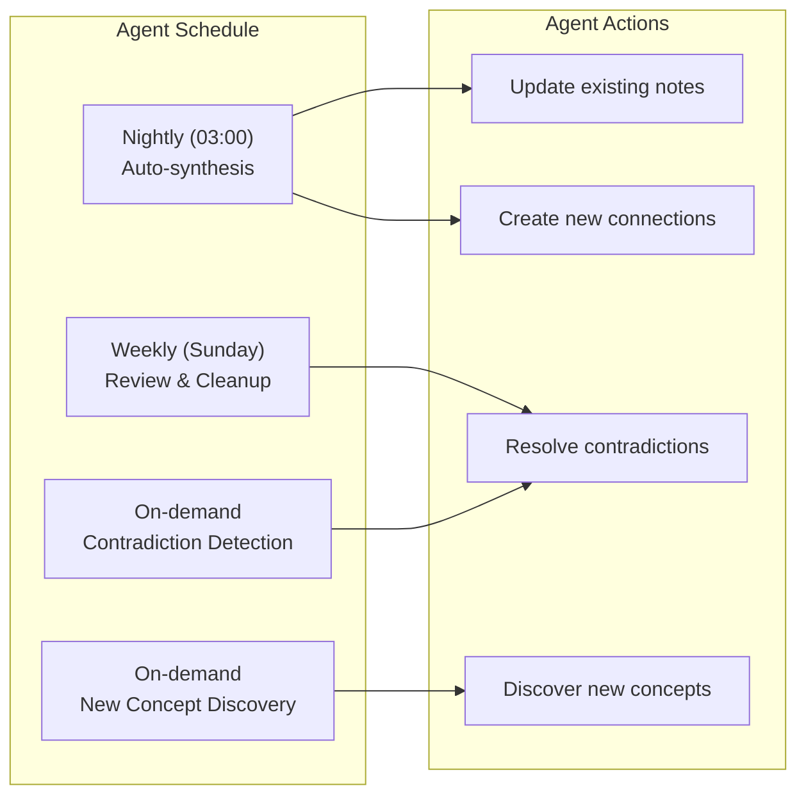

# obsidian-second-brain Architecture

## System Overview



## Core Components

### 1. Command Layer (44 Commands)

| Layer | Count | Purpose |
|-------|-------|---------|
| Vault Management | 12 | Save, ingest, organize, maintain vault |
| Thinking Tools | 8 | Challenge assumptions, find contradictions, explore ideas |
| Research Toolkit | 14 | X/Twitter, web research, YouTube, NotebookLM, deep research |
| Scheduled Agents | 10 | Nightly synthesis, weekly review, challenge, emerge |

### 2. Platform Adapters
- **Claude Code**: Identity copy (native slash command format)
- **Codex CLI**: Compiles to `AGENTS.md` + `.codex/commands/`
- **Gemini CLI**: Compiles to `GEMINI.md` + `.gemini/commands/`
- **OpenCode**: Compiles to `OPENCODE.md` + `.opencode/commands/`

### 3. Core Engine
- **Command Dispatcher**: Routes commands to appropriate handlers
- **AI-First Validator**: Ensures vault writes follow AI-first rules
- **Vault Compiler**: Transforms raw sources into compiled wiki articles
- **Auto-Synthesizer**: Nightly agent that updates and connects notes

### 4. Vault Layers
- **raw/**: Unprocessed sources (URLs, PDFs, transcripts)
- **wiki/**: Compiled, reviewed articles with citations
- **schema/**: Templates, frontmatter rules, validation schemas
- **meta/**: Indexes, access logs, vitality scores

## Data Flow



## AI-First Vault Principle

Every note written to the vault follows the AI-First specification:

```markdown
---
title: "Concept Name"
type: concept
date: 2026-08-01
tags: [domain, topic]
ai-first: true
sources: ["[[raw/articles/source.md]]"]
coverage: medium
confidence: high
---

## For future Claude

Context for AI retrieval: this note covers X, relates to Y, and was compiled from Z.

# Concept Name

Core explanation with [[wikilinks]] to related concepts.

## Details

Extracted information with source attribution.

## Relationships

- Builds on [[Foundation Concept]]
- Contradicts [[Other Claim]] on X

## Sources

- [[raw/articles/source.md]] -- key claims from this source
```

## Scheduled Agents



## Key Design Decisions

1. **Vault Rewrites Itself**: Every source updates existing pages instead of just appending
2. **AI-First Notes**: Notes designed for AI retrieval, not human reading
3. **Multi-Platform**: One codebase, four CLI platforms
4. **Scheduled Agents**: Autonomous agents that maintain vault health
5. **Dry-Run Default**: All write operations are dry-run unless explicitly applied
6. **File-Based State**: All state in files, no database, no cloud dependency

## Technology Stack

- **Primary**: Markdown, YAML frontmatter
- **Scripting**: Python 3.11+, Bash
- **Platforms**: Claude Code, Codex CLI, Gemini CLI, OpenCode
- **External APIs**: Perplexity, Grok, Gemini File Search, YouTube, X/Twitter
- **Build**: esbuild, shell scripts

## File Structure

```
obsidian-second-brain/
├── commands/               # 44 slash command definitions
│   ├── obsidian-save.md
│   ├── obsidian-ingest.md
│   ├── obsidian-architect.md
│   └── ...
├── adapters/               # Platform translation layer
│   ├── claude-code/
│   ├── codex-cli/
│   ├── gemini-cli/
│   └── opencode/
├── scripts/                # Python helpers
│   ├── research/
│   ├── bootstrap_vault.py
│   └── vault_health.py
├── references/             # Shared specs
│   └── ai-first-rules.md   # Canonical vault-write spec
├── hooks/                  # Claude Code hooks
├── dist/                   # Build output (gitignored)
├── SKILL.md                # Full operating manual
└── README.md               # Public documentation
```
